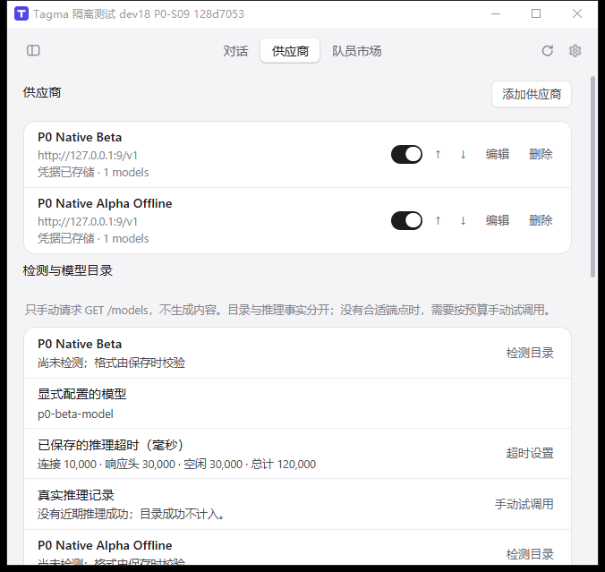
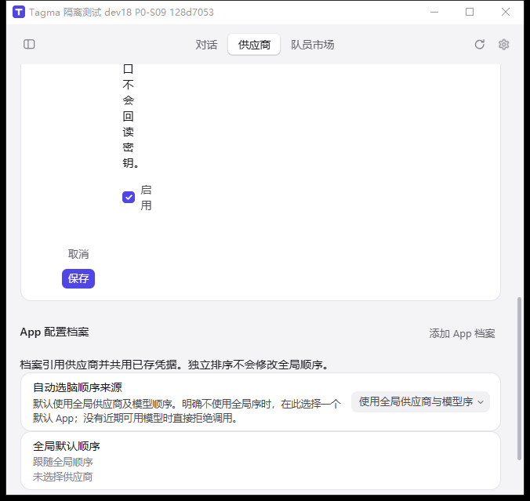
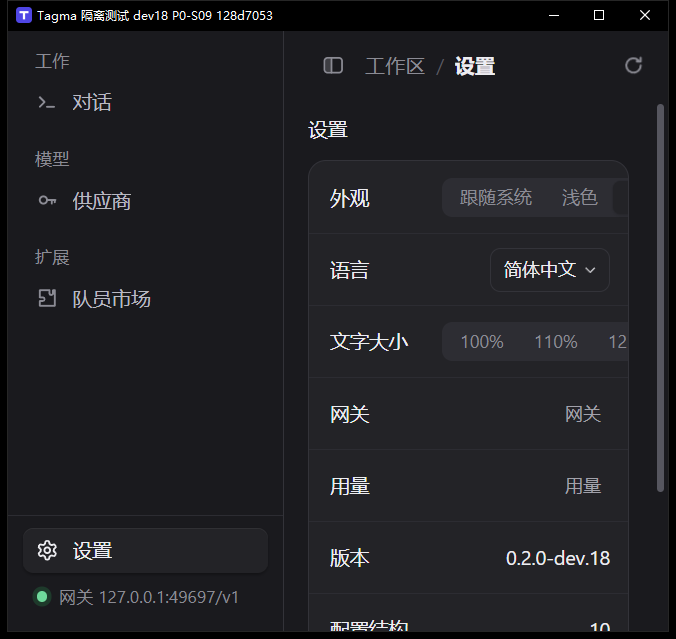

# P0-S11 原生主流程验收与两处布局修复

2026-10-18。接续 `fdaf657`，复用唯一 `D:/demo1/tagmaai` 工作树与现有 dev.18 独占实例。继承 dirty、默认数据库/凭据、用户 preview、历史证据均保留；`tagma-prd`、`magpie-cis`、RUN-BINDING 现场读回仍 PAUSED，无定时任务、旧聊天或子代理唤醒。

## 本批结果

**dev.18 的供应商保存、排序、停网关保存、完全退出宿主后恢复、顶部/侧栏自由拖动已取得真实原生通过证据。P0 整体仍未通过。** 后续发现的表单布局、150% 设置裁切已修复源码并生成 dev.19，随后在同一隔离数据目录完成定向原生复验。两版结果分别记录，独立浏览器检查不冒充原生证据。

原生记录：[summary.json](evidence/P0-S11/summary.json)、[原生动作与观察](evidence/P0-S11/native-actions.jsonl)。动作由 Windows UI Automation、PrintWindow 和 SendInput 完成，没有注入 WebView JS、绕过表单写数据库或调用后台接口冒充 UI。请求中的合成凭据文本在归档时省略，密码控件从未回读。

## 通道诊断与授权边界

用户明确答复“允许切换本机原生通道”，原问题限定现有 dev.18 隔离实例。使用固定路径、owner 标记、宿主 SHA256、PID/start-time、唯一窗口标题、UIA RuntimeId 与观察有效期校验；鼠标/键盘动作额外要求前台 HWND 与目标一致、坐标落在该窗口。控制脚本见 [Control.ps1](evidence/P0-S11/Control.ps1)。没有操作其他应用、系统设置或真实凭据。

现场发现 PID45604 真正带隔离标题的 HWND593796 当时 `Visible=false`；`Process.MainWindowHandle` 指到可见的空标题辅助窗口462728。仅枚举该进程自有窗口，按确切标题选中并恢复真实主窗后，PrintWindow2 取得清晰像素，鼠标打开表单、Unicode SendInput 输入名称、UIA 表单填写与保存成功。这个发现解释当前隐藏窗状态，**不证明此前跨 WinForms/Tagma 的 sky/WGC 故障根因已修复**；本批没有重连/重置 sky。

通道不是无限制稳定：后续前台获取失败时，保护检查在发送输入前返回 `Could not foreground target` 或 `Wrong foreground window`。停止同类尝试，保留原生键盘遍历未验项。主题控件一次不支持 InvokePattern，检查其真实能力后改用 TogglePattern。另一次窗口尺寸/导航/空编辑器状态在脚本没有相应动作时变化；旧 RuntimeId 校验拒绝操作，重新观察后取消空表单，不推断外部原因。

## dev.18 原生实测

候选宿主 SHA256 `2233c33385bf37a16316e8ab66047d3631ea1493fe21dce2cded26758d29d7bf`。独占根目录 `C:/Users/ai/AppData/Local/Temp/tagma-p0-s09-128d7053-66d3-424a-8ec2-90640d06bf88`，端口49697，复用其 data/webview。没有创建访问令牌，没有检测目录、推理或付费上游调用。

| 操作 | 原生观察 | 结论 |
| --- | --- | --- |
| 新增两条供应商 | Alpha/Beta，URL均为 `http://127.0.0.1:9/v1`，不同模型与合成凭据；保存修订1、2，页面“凭据已存储” | 通过；不等于真实上游可调用 |
| Beta 上移 | 顺序变为 Beta → Alpha，全局默认顺序同步；修订3，随后3/3 | 通过 |
| 停止网关 | UI“已停止”，effective“未确认”；自有 sidecar 和49697监听消失 | 通过 |
| 停止期间编辑保存 | Alpha改为 `P0 Native Alpha Offline`、模型 `p0-alpha-offline`；密钥留空，原凭据状态保留；desired4/effective未确认 | 通过；未伪造生效 |
| 完全退出与重启 | 点击“退出 Tagma”，宿主45604与监听确实消失；同一 launcher 启动宿主45804、网关36548；顺序、改名、模型、凭据状态保留，4/4 | 通过，见 [退出证明](evidence/P0-S11/19-quit-proof.json)、[恢复页面](evidence/P0-S11/21-recovered-providers.json) |
| 顶部空白区物理拖动 | rect `[1582,744,2258,1383]` → `[1682,804,2358,1443]`，+100/+60 | 通过，SendInput真实鼠标按下/移动/抬起 |
| 导航按钮拖移 | 同样拖移手势从“供应商”按钮出发，窗口rect不变 | 通过 |
| 侧栏顶部空白区物理拖动 | 上述rect回到 `[1582,744,2258,1383]`，−100/−60 | 通过 |
| 双击产品顶部空白区 | 最大化rect `[-8,-8,3848,2128]`，再双击恢复原rect | 通过 |
| 删除专用合成记录 | 临时第三条 `P0 Native Disposable` 保存为revision5；原生删除确认框明确显示其名称，确认后仅保留原两条，最终6/6 | 通过；首次Invoke后未观察到对话框，重新观察后一次重试取得对话框，未盲目确认 |
| 语言、主题、二层用量 | 英语菜单项聚焦后Return选择，焦点回语言按钮；深浅主题变化；设置→用量→返回设置可用 | 这些动作通过，A06整体未过 |

## 已复现并修复的界面缺陷

1. `ProviderForm` 等使用 `editor tagma-editor`，CIS `.editor` 本来给直接 label/control 子节点提供72px首列；产品将字段再包一层 fieldset，导致整个 fieldset 被塞进首列。实测输入框只有约22px宽，提示文字逐字竖排。产品专用 `.tagma-editor` 改为 block，fieldset保留网格且允许收缩；按编辑器实际宽度切换单列，覆盖侧栏和文字放大，不更改冻结CIS。
2. 侧栏150%时设置行 `.val` 的60%约束和不换行选项导致右侧深色/150%按钮裁切。给设置section添加产品类，仅在该范围允许行、值区和分段选择器换行；保持控件原CIS颜色、尺寸和动效。

产品提交：`cd2bc9fb9580d62c35f63fcf3c423a1544e10383`，版本dev.19。源码只改变上述组合布局与版本，未改配置/凭据/网关业务或继承样式。

## 定向验证与自查

- 独立、隐藏、独占 profile 的已缓存 Chromium，渲染实际 ProviderForm/PrefRow/Segs 与完整CSS导入顺序。先用fdaf657旧CSS复现缺陷，再验证新CSS。中英 × 顶部/侧栏 × 110%/150%共8组修复检查通过，字段无横向越界且选项不裁切。第一轮仍有英语侧栏150%输入过窄，已保留失败记录并改为容器宽度响应布局；第二轮通过。[检查脚本](evidence/P0-S11/layout-check.mjs)、[结果](evidence/P0-S11/layout-result.json)。**这是合成浏览器布局检查，不是新候选原生验收。**
- 30项源码/组件/模拟桥接测试、TypeScript、ProductApp定向oxlint、CIS/chrome guard、源码diff检查通过。没有重复历史热修复矩阵或手动CI。
- Tauri debug NSIS构建成功；已知ts-rs `deny_unknown_fields` warning保留，退出码0。完整306个输入在构建前采集hash，构建后全匹配。
- 两轮自查：一轮定位实际CSS级联/父子结构及受影响表单，另一轮以中英、两导航和两字号边界核对几何，并检查原生证据的PID/版本/修订来源。窗口动作与后台检查不混记。

## dev.19 候选

[内部安装包](D:/demo1/tagmaai-deliveries/0.2.0-dev.19/Tagma_0.2.0-dev.19_x64-setup.exe)，6,621,505字节，SHA256 `53ec8ff5e13df83ec34c0b9ecfc2a0a5e910422e5cdaa1786f21255bfc49403f`。Windows x64 debug/未签名，安装器未运行、未发布。来源为cd2bc9f+继承dirty，不称clean构建。

见 [交付manifest](evidence/P0-S11/dev19-delivery.json) 和 [306输入冻结记录](evidence/P0-S11/dev19-source-frozen.json)。相比dev.18恰好只有本批5个文件不同；复用并引用已有dev.18 source-overlay恢复其余继承dirty，不重复旧包源码保全。dev.18宿主文件保持原hash；没有覆盖它或用户preview。

用户指出前一次扩展范围确认多余，并要求后续不再询问。按原项目开发目标继续本批可逆隔离验收：原生退出dev.18后，在原独占目录的`candidate-dev19`子目录仅放新的宿主/sidecar，复用既有data/webview和49697端口。旧二进制保留，未复制环境/数据库或初始化令牌。

首次PowerShell5启动脚本以无BOM UTF8保存，中文标题字面量被错误解码，宿主保留默认`Tagma`标题，标题保护拒绝继续。只读核对精确EXE/hash、WebView目录、sidecar配置目录及端口仍是本fixture，随后通过其原生退出，修正脚本UTF8 BOM并重新启动；不是产品打开默认库的问题。最终PID30236、HWND2621474、标题`Tagma 隔离测试 dev19 P0-S11 128d7053`。启动后仍6/6，删除的临时供应商未回来。

原生定向复验通过：[中文侧栏150%设置](evidence/P0-S11/dev19/03-settings-150.png)、[中文侧栏150%表单](evidence/P0-S11/dev19/04-form-side150.png)、[表单底部按钮](evidence/P0-S11/dev19/07-form-actions-side150.png)、[英文侧栏150%设置](evidence/P0-S11/dev19/08-english-side150.png)、[英文顶部110%表单](evidence/P0-S11/dev19/09-english-top110-form.png)。后者UIA实际读到输入宽426px；这些页面不再出现窄条/选项裁切。最终恢复简体中文/浅色/110%/顶部导航，关闭空表单并留供应商页面供继续开发。

## 未验和下一步

- dev.19两处修复已原生复验；版本升级读取同一隔离数据成功。完整五项主流程的首次闭环仍归属dev.18，未重复未受影响的后端矩阵。
- A06完整Tab/Shift+Tab遍历、编辑器取消回焦、减弱动效、其他语言/长文本/错误忙态矩阵仍未完成。取消后本批观察焦点落在Document，未记为回焦通过；dev.19的一次Tab仍在发送前被前台保护拒绝。下一动作先修复并验证回焦，再补其他缺口。
- A03/A04/A05/A07沿用既有明确版本/层级证据；不能把本批正常完全退出恢复当成壳崩溃、托盘恢复、同时启动、其他程序占端口或未知库全部通过。
- 干净安装/升级卸载、签名、macOS、登记设备性能等A23/A24门槛仍未过；P1真实资源与原生闭环、ReachFlow P2、P3不放行。

本批只保留一个工作树。构建前C/Temp36.107 GiB、D32.061 GiB；复用node_modules/Cargo target，无新依赖、模型、worktree。预算D增量2.13 GiB、C/Temp1 GiB，保持10 GiB余量。

独立浏览器进程已关闭；其专用profile经边界/重解析点/进程/写入/锁检查后，删除命令被自动审批在执行前以 `blocked by policy` 拒绝，删除0、不绕过重试。保留 `D:/demo1/tagmaai/.cache/p0-s11-native-control/layout-browser-profile`（逻辑1,757,648字节）及本批必要缓存/证据。默认库、所有历史fixture/交付/preview保留。保留责任：当前项目执行者；复查日期2026-10-25，仅记录，不创建调度。

收尾C/Temp35.963 GiB、D31.318 GiB，盘差包括并发写入，不当作本任务净占用。必要证据观察时逻辑5,780,997/按NTFS文件身份去重分配5,895,592字节；本批缓存10,558,351/10,761,144字节；dev.19交付6,677,409/6,684,672字节；同fixture新增的可运行候选30,350,336/30,355,456字节。计数未包含其后写入的本条收尾记录自身。只报告当前占用，不声称净释放；[closeout.json](evidence/P0-S11/closeout.json)记录计算方式及进程。保留唯一工作树、缓存、dev.18历史文件、dev.19内部包和当前隔离实例，无新增环境或worktree。
